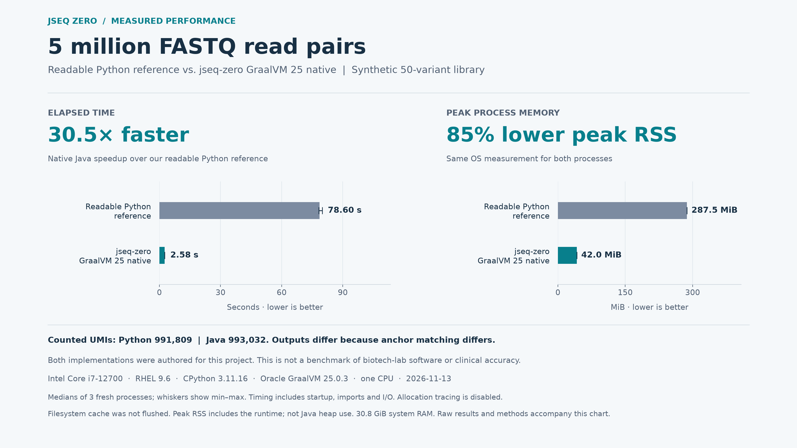

# jseq-zero

Allocation-conscious Java 25 primitives and CLI tools for paired-end sequencing barcode demultiplexing and UMI deduplication. Available as a standalone **GraalVM 25 native executable**: no Java installation or JIT warmup is required to run the Linux binary.

## Measured performance

**5 million read pairs in 2.575 seconds — 30.5× faster than our readable Python reference on this synthetic workload.**



| Measurement | Readable Python reference | jseq-zero · GraalVM 25 native |
| :--- | ---: | ---: |
| Median end-to-end time | 78.595 s | 2.575 s |
| Observed time range | 78.240–79.870 s | 2.575–2.589 s |
| Throughput at median time | 63,617 pairs/s | 1,941,598 pairs/s |
| Median peak process memory (RSS) | 287.5 MiB | 42.0 MiB |
| Unique UMIs counted | 991,809 | 993,032 |
| Read pairs with no anchor found | 161,789 | 0 |
| Read pairs with unmatched barcode | 25,627 | 25,627 |

The 161,789 additional matched read pairs produced 160,566 additional PCR-duplicate counts and 1,223 additional unique UMI counts, consistent with the dataset’s average 5× sampling depth.

Native Java used **85.4% less peak RSS** in this measurement. These are medians of three fresh processes on **Intel Core i7-12700, 30.8 GiB RAM, RHEL 9.6**, with each benchmark process pinned to one CPU. Runtime versions: **CPython 3.11.16** and **Oracle GraalVM 25.0.3+9.1**. Wall time includes startup, imports and I/O; peak RSS is total process memory, not Java heap. The native heap limit was 512 MiB. Filesystem caches were not flushed.

Both implementations were authored for this project. The [Python reference](scripts/baseline_demux.py) uses ordinary strings, sets and counters, dictionary lookup for exact barcodes, and a straightforward Hamming-distance scan for approximate matches. It has no allocation tracing or artificial delays. This comparison measures these implementations on a synthetic 50-variant library; it does not establish a general Java-versus-Python speedup or benchmark software from a biotech laboratory.

**Matching behavior differs:** native Java also supports an indel-tolerant anchor fallback. It counted 1,223 additional UMIs across 1,221 cell/variant rows; Python had no extra counts. Both accept barcode matches with up to two substitutions. Output totals reconcile with the TSV files and remain identical across repeats for each implementation. This is not a ground-truth accuracy or clinical validation study.

[Full methods and hardware](docs/benchmarks/2026-11-13/README.md) · [Raw CSV](docs/benchmarks/2026-11-13/results.csv) · [Raw JSON](docs/benchmarks/2026-11-13/results.json) · [Chart PDF](docs/benchmarks/2026-11-13/benchmark-comparison.pdf) · [Editable SVG](docs/benchmarks/2026-11-13/benchmark-comparison.svg)

## Run the native binary

Download the **Linux x86-64 native preview** and its SHA-256 file from the [release page](https://github.com/CraftOfProgramming/jseq-zero/releases/tag/v1.0.0-preview.1). It requires **glibc 2.34+ and libz.so.1**, and targets the GraalVM compatibility CPU baseline. The supplied executable is the exact binary used for the published benchmark.

```bash
sha256sum -c jseq-zero-1.0.0-linux-x86_64.tar.gz.sha256
mkdir jseq-zero-native
tar -xzf jseq-zero-1.0.0-linux-x86_64.tar.gz -C jseq-zero-native
cd jseq-zero-native
./jseq-zero --help

# Synthetic input: 1M candidate molecules, 5x PCR depth, 50 variants.
./jseq-zero -Xmx512m generate-benchmark 1000000 5 50
./jseq-zero -Xmx512m amplicon-demux library_barcodes.tsv R1.fastq R2.fastq jseq_counts.tsv
```

The generator uses a fixed seed and samples candidate molecules with replacement; one million candidates does not guarantee one million observed unique molecules. Native binaries are platform-specific: build locally for macOS or another target platform.

## Run the cross-platform JAR

Download [jseq-zero.jar](https://github.com/CraftOfProgramming/jseq-zero/releases/download/v1.0.0-preview.1/jseq-zero.jar) and its [SHA-256 file](https://github.com/CraftOfProgramming/jseq-zero/releases/download/v1.0.0-preview.1/jseq-zero.jar.sha256). The executable JAR includes its dependencies and requires **Java 25**. Use a Java installation for your platform, including Apple Silicon macOS, Linux or Windows.

```bash
# macOS checksum verification; on Linux, use sha256sum -c instead.
shasum -a 256 -c jseq-zero.jar.sha256
java -jar jseq-zero.jar --help
java -Xmx512m -jar jseq-zero.jar amplicon-demux library_barcodes.tsv R1.fastq R2.fastq jseq_counts.tsv
```

The JAR uses the `com.craftofprogramming.jseqzero` namespace; its exact source commit, build environment and checksum are recorded in [jseq-zero-jar-build-info.json](https://github.com/CraftOfProgramming/jseq-zero/releases/download/v1.0.0-preview.1/jseq-zero-jar-build-info.json). It is a supplemental JVM artifact built after the original preview tag. The published performance measurements apply to the unchanged Linux native executable, not this JAR; no new benchmark or native build was run for this addition.

## Build from source

A single Maven module produces `target/jseq-zero.jar`. Use **JDK 25**; the published native build used **Oracle GraalVM 25.0.3** and Maven **3.6.3**. The project also builds with Maven 3.9.

```bash
mvn clean verify
java -jar target/jseq-zero.jar --help

# With GraalVM 25 active, compile the standalone executable.
native-image -J-Xmx8g --parallelism=4 --no-fallback -O3 -march=compatibility \
  -jar target/jseq-zero.jar target/jseq-zero
./target/jseq-zero --help
```

The direct Native Image command above produced the measured binary. The repository also contains an optional Maven `native` profile. All published performance figures use AOT native execution.

## Correctness and coverage

The Java suite has **19 passing tests**, including DNA encoding and matching boundaries, ambiguous barcode matches, plain/gzip FASTQ input, buffer limits, truncated input, unequal paired-read counts, UMI deduplication and generator validation. JaCoCo reports **92.0% line coverage (391/425)** and **82.1% branch coverage (188/229)**. Six Python reference tests and nine native integration checks also pass.

```bash
mvn verify
# Coverage report: target/site/jacoco/index.html
python3 -m unittest discover -s scripts -p 'test_*demux.py'
python3 scripts/verify_native.py /absolute/path/to/jseq-zero --report native-checks.json
```

Coverage describes exercised code, not biological validation. This initial release still needs validation against representative real datasets and established demultiplexing tools.

## Implementation

- **`Dna2Bit`** packs DNA bases into two-bit words and computes Hamming distance with bit operations and population count.
- **`BitapFlankFinder`** finds the constant anchor using a fast matching path and a bounded edit-distance fallback.
- **`PigeonholeBarcodeIndex`** uses three seed slices in a compact index to narrow approximate barcode candidates.
- **`FastqRecordReader`** streams plain or gzip FASTQ into reusable buffers. Primitive Agrona collections store molecule signatures and cell/variant counts.

The hot path avoids per-record `String` construction. Setup, collection growth, generation and output still allocate; zero allocation has not been established by profiling. The included [Nextflow workflow](workflow/main.nf) is an integration example and was not part of the native benchmark validation.

## Reproduce the benchmark and chart

Use the release binary and its included `build-info.json` on Linux, with Python 3.11 or later. Follow the [reproduction commands](docs/benchmarks/2026-11-13/README.md). The benchmark and reference require only the Python standard library; chart rendering has separate pinned dependencies.

## Optional optimized Python reference

[`scripts/optimized_demux.py`](scripts/optimized_demux.py) is a separate optimization example using binary reads, indexed approximate lookup, cached matches and compact integer keys. It is included for inspection and experimentation. The published benchmark and chart use the readable `baseline_demux.py`; the 30.5× speedup does not describe this optional optimized implementation.

```bash
python3 scripts/optimized_demux.py library_barcodes.tsv R1.fastq R2.fastq optimized_counts.tsv
```

## License

Application source is licensed under [Apache-2.0](LICENSE), with notices in each source file. The native distribution also contains Agrona and Oracle GraalVM runtime components under their respective terms; their original license notices accompany the download. See [third-party notices](THIRD-PARTY-NOTICES.md).
